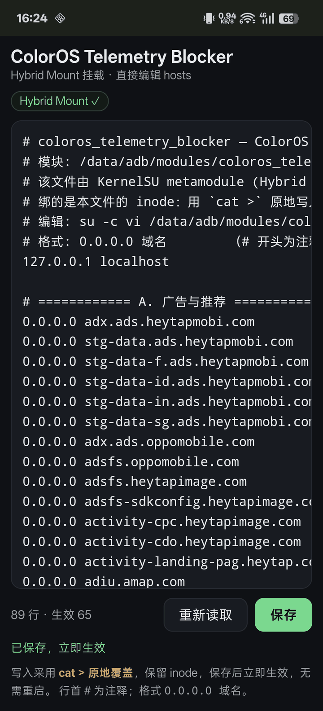

# ColorOS Telemetry Blocker

一个只做一件事的 KernelSU 模块：用 hosts 把 ColorOS / OPPO 的**广告推荐、遥测上报、应用画像**域名解析到 `127.0.0.1`。

- **不自己挂载** —— 交给 KernelSU metamodule（Hybrid Mount），模块里没有一行 `mount`
- **不带命令行** —— 在模块管理器里点开，用内置的图形化编辑器改，保存即生效
- **可随时增删** —— 清单是明文 hosts，按段分组，改完不用重启



## 为什么

ColorOS 里有一整套把「你在用什么 App、用了多久」采集起来做推荐的组件。静态分析 `metis` / `deepthinker` / `mcs` / `olc` / `onetrace` 之后可以确认：

| 组件 | 角色 |
|---|---|
| `com.oplus.metis` | 采集主体：`HabitCounter`、`ActiveAppInfo`、`appSwitchStatistics`、`appUseTime`，上报到 `mdp-usertrace-cn` / `usop-api-cn` / `adx.ads` |
| `com.oplus.deepthinker` | 汇总画像：`BridgeServerImpl$appUsageSortImpl`、`AppPortrait`，走 `odin.*` |
| `com.heytap.mcs` | 带 `sendToDcc`（数据收集中心）、`appSwitchStatisticFrequency` 等开关 |
| `com.oplus.olc` | 日志上传（`logUpload`） |
| `com.oplus.onetrace` | 埋点链路 |

`DCC`（Data Collection Center）这类开关的存在本身就说明采集管道是真的。这份 hosts 清单就是把它们的**上报端**堵掉——本地行为不变，只是出不去。

## 屏蔽范围

`system/etc/hosts` 共 **65 条**，按用途分段，想关哪段注释掉即可：

| 段 | 内容 |
|---|---|
| A | 广告与推荐：`adx.ads.*`、`adsfs.*`、`activity-cpc/cdo` |
| B | 遥测上报：`mdp-usertrace-cn`、`odin.*`、`*tracing*`、`rest-cn-feedback` |
| C | 安全云查：`safe.*`、`sec.*` |
| D | 应用画像：`usop-api-cn`、`pantanal-intelli-cn`、`sense-intent-cn-01`、`bot-brain-cn`、`nebula-api-cn` |
| E | 默认被注释的候选条目，按需启用 |

## 环境要求

- KernelSU / KernelSU Next / ReSukiSU（管理器需要支持模块 WebUI）
- 已启用 **Hybrid Mount**（或其它会处理 `system/` 覆盖的 metamodule）
- Android 8.0+（`minSdk 26`），已在 Android 16 / ColorOS 上实测

## 安装

1. 从 [Releases](../../releases) 下载 `coloros_telemetry_blocker-vX.Y.zip`
2. 模块管理器 → 模块 → 从文件安装
3. **重启**（metamodule 在开机阶段接管挂载）
4. 长按模块卡片打开编辑器，顶部应显示 `Hybrid Mount ✓`

排查：

```sh
su -c head -3 /system/etc/hosts              # 应该看到本模块的头部注释
su -c cat /data/adb/hybrid-mount/run/state.json | grep coloros
su -c ping -c1 adx.ads.heytapmobi.com        # 应解析到 127.0.0.1
```

## 使用

长按模块卡片 → 图形化编辑器：

- 顶部胶囊 `Hybrid Mount ✓` = 当前已由 metamodule 挂载
- 底部 `行数 · 生效条数`
- 改完点 **保存**，立即生效，无需重启

保存做了三件事，缺一不可：

```sh
echo '<base64>' | base64 -d > $TMP
cat $TMP > system/etc/hosts          # ① 原地覆盖，保留 inode
chown 0:0 …; chmod 644 …
chcon u:object_r:system_file:s0 …    # ② SELinux 标签必须是 system_file
```

1. **必须保留 inode**。magic mount 绑的是宿主文件的 inode，`sed -i` / `cp` 会换 inode，挂载变成孤儿——表现为 `cat` 看着对、`ping` 却解析到真实 IP。
2. **必须 `chcon system_file`**。`/data/adb` 下新建的文件默认是 `adb_data_file`，解析器读不到，hosts 被**静默忽略**。
3. 保存后会 `cat` 回读比对，不一致直接报错，不会假装成功。

手动改文件时同样遵守这两条。

## 注意事项

- **走代理的 UID 不受 hosts 影响**。FlClash 之类用 fake-ip 的 TUN，被代理的流量不查 hosts；系统组件（uid 1000）通常不在代理列表里，所以对 OPPO 组件有效。
- **不要屏蔽推送域名**：`onepush-identity-cn.*`、`httpdns-push*`——会收不到通知。
- **不要屏蔽** `sport.health.heytapmobi.com`（健康数据同步）。
- **不要 `pm disable-user com.oplus.metis`**：它是 `AppRecommendContentProvider` 的宿主，禁了会拖累桌面。
- 这份清单只堵上报端，不改系统行为，也不影响应用正常使用。

## 卸载

模块管理器里删除模块，重启即可。想临时停用：

```sh
su -c touch /data/adb/modules/coloros_telemetry_blocker/disable
```

## 开发

见 [DEVELOPMENT.md](DEVELOPMENT.md)。构建：

```sh
python build.py     # 产物 dist/coloros_telemetry_blocker-v<version>.zip
```

## 更新记录

| 版本 | 变更 |
|---|---|
| v2.0 | 从 `noir_hosts` 改名，去脚本化 |
| v2.1 | 挂载完全交给 KernelSU metamodule |
| v2.2 | 加 WebUI 图形编辑器，去掉 ctb 命令行 |
| v2.3 | 修正 WebUI 桥调用（`ksu.exec(cmd)` 单参、直接返回 stdout），保存后回读校验 |

## 许可

[MIT](LICENSE)
